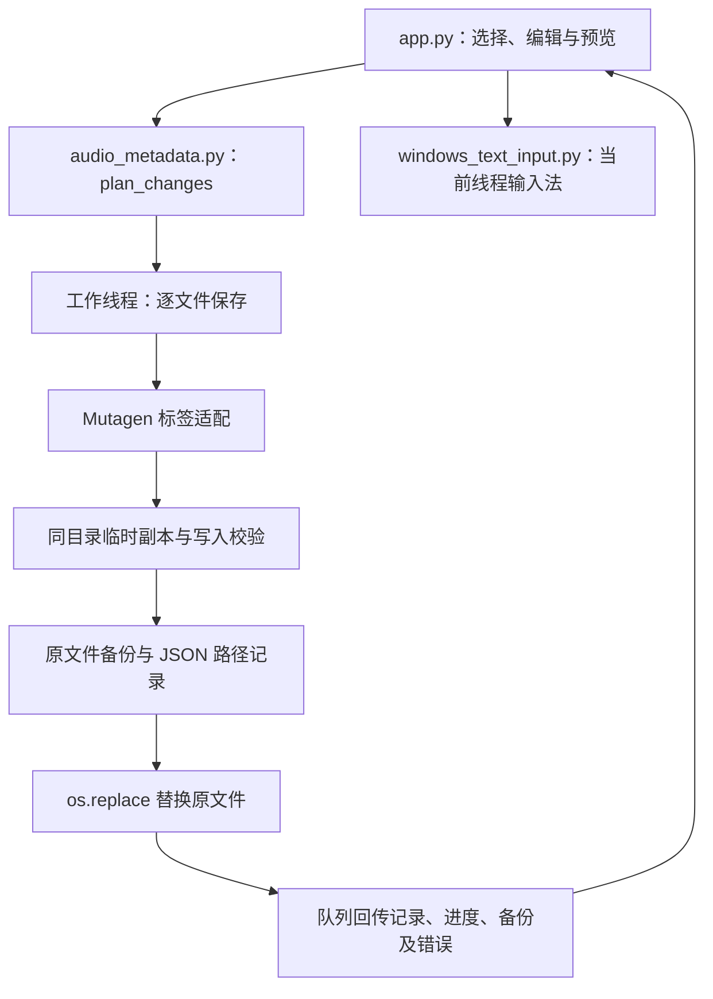

# 架构与数据流程

## 模块关系



## 数据模型和单位

| 对象 | 主要内容 |
| --- | --- |
| `Signature` | 文件大小 `size`（字节）和修改时间 `mtime_ns`（纳秒） |
| `AudioRecord` | 绝对路径、实际标签、格式、编码、时长、码率、采样率、声道、位深和读取时的签名 |
| `BackupRecord` | 原文件路径、完整备份路径、保存完成后的文件签名 |

`AudioRecord.duration` 使用秒，`bitrate` 使用 bit/s，`sample_rate` 使用 Hz。界面负责换算为时长、kbps、kHz 和文件大小文本。

标签在内部统一为 `dict[str, str]`，缺失值为空字符串。多值标签读取后以 `; ` 连接展示；写入的新文本作为一个值保存，不会按分号重新拆分。

## 格式与标签适配

| 音档类型 | 标签实现 |
| --- | --- |
| MP3、WAV、AIFF | ID3 帧，通过 `ID3_FRAMES` 映射；备注使用 `COMM` |
| M4A/M4B/MP4（含 AAC、ALAC） | MP4 atom，通过 `MP4_KEYS` 映射；音轨与碟号转换为编号元组 |
| FLAC、Ogg Vorbis、Ogg Opus、Ogg FLAC | Vorbis Comment 风格的标签键 |
| WMA/ASF | 通过 `ASF_KEYS` 映射 |

`discover_files()` 依据扩展名筛选候选文件，`_load()` 再使用 Mutagen 识别实际内容与支持类型。文件夹扫描默认递归，跳过备份目录、目录符号链接和扫描到的符号链接文件；重复的解析后路径只产出一次。

日期只接受 `YYYY`、`YYYY-MM`、`YYYY-MM-DD` 并检查日历有效性。音轨和碟号接受正整数或 `编号/总数`，不超过 65535，且编号不能大于总数。字段值写入前会去除首尾空白，并拒绝空字符。

没有可用码率时，按文件总大小和时长估算，界面加 `≈`；此估算包含标签与容器开销。Opus 的采样率展示在缺少属性时回退为 48 kHz。ID3 保存沿用 Mutagen 的 ID3v2.4 行为；不同播放器对 WAV/AIFF 标签的识别可能不同。

## 修改计划与空标题规则

`preview_save()` 只收集勾选字段，再交给 `plan_changes()` 生成每个音档独立的修改字典。规则顺序如下：

1. 校验手动输入，保留与实际标签不同的字段。
2. 启用自动补填、用户未手动指定标题、且原标题为空或仅含空白时，补入 `record.path.stem.strip()`。
3. 没有变化的音档不加入保存任务。

`Path.stem` 只去掉最后一个扩展名。例如 `演唱会.live.flac` 得到 `演唱会.live`。批量补填按每首音档自身路径生成，不能把单首文件的建议标题复制给整个批次。

手动标题优先，包括主动清空；关闭自动补填后，空标题也保持原状。没有勾选任何字段时，仍可单独生成自动补填计划。

列表中的“待补填”和编辑区建议只是展示。`read_audio()` 与扫描操作均不会修改原文件；确认预览后才写入。`_loading_values` 防止载入公共值被误认为用户编辑，已勾选的待修改内容会在切换选择时保留。

## 保存、备份和恢复

`save_audio()` 的单文件流程：

1. 比较当前文件签名与读取时的签名。
2. 在原目录创建 `.audioedit-` 临时文件，并复制原文件。
3. 修改副本标签，重新读取，并逐项校验拟写入值。
4. 再次检查签名，将完整原文件复制到备份目录并写入 JSON 路径记录。
5. 再次检查签名，通过 `os.replace()` 将副本替换到原路径。
6. 读取更新后的信息，返回 `AudioRecord` 和 `BackupRecord`，最后清理临时副本。

备份布局如下；备份音档名前有随机前缀，用于区分同名文件：

```text
音乐目录/
  晴天.mp3
  .audio-tag-backups/
    批次编号/
      随机前缀_晴天.mp3
      随机前缀_晴天.mp3.json
```

JSON 字段为 `original`、`backup` 和 `created`。`created` 是无时区偏移的本机时间文本，路径记录用于程序关闭后的手动恢复；备份不会自动清理。

工作线程逐首保存，某首失败后继续处理其余文件。停止按钮只在文件之间生效，不中断当前文件的写入步骤。这是逐文件操作，不是整个批次一起提交或回滚。

替换前的写入或备份失败不会修改原文件。替换后若再次读取失败，原文件可能已经更新，应先检查文件与备份。签名检查使用大小和修改时间，不是内容哈希，也不是文件锁，不能视为消除了所有并发修改窗口或断电风险。

`restore_audio()` 检查保存后的签名，确认文件未再次变化后，从备份创建副本并替换回原路径。自动撤销只保存于当前进程内；失败的恢复项会保留供重试。持久备份仍可用于手动恢复。

## 后台任务与界面线程

`_start()` 启动守护线程，界面线程的 `_poll()` 每 80 毫秒处理队列，每轮最多取 150 个事件。

| 队列事件 | 内容 |
| --- | --- |
| `record` | 新读取或更新后的 `AudioRecord` |
| `status` | 当前操作说明 |
| `progress` | 已处理数与总数 |
| `error` | 文件路径和错误原因 |
| `backups` | 可用于撤销的备份记录 |
| `finished` | 任务完成说明，触发控件恢复与列表刷新 |

任务期间禁用编辑和主要操作。请求关闭窗口时，如果任务仍在运行，则先请求停止，等当前文件结束后再关闭。应用退出时取消轮询并释放输入法资源。

## Windows 中文输入法

`WindowsTextInput` 在创建 Tk 窗口前初始化当前线程的 COM apartment，并尝试激活 TSF 线程管理器。输入框获得焦点时检查 IMM 上下文：已有上下文就保留，缺失时先关联默认上下文，再尝试创建程序自行管理的上下文。

“中文输入”按钮选择已安装的中文键盘布局，连接上次聚焦的文本框（尚未聚焦时使用歌手框），并请求开启中文模式。布局选择只针对当前界面线程；程序不安装输入法、不更改系统语言配置。

程序退出前恢复自行关联的上下文，销毁自行创建的资源，并配对释放 TSF/COM。受限执行环境可能无法访问系统输入法，所以输入法测试和正式使用应在普通 Windows 桌面中进行。非 Windows 环境不会调用这些 Win32 API。
